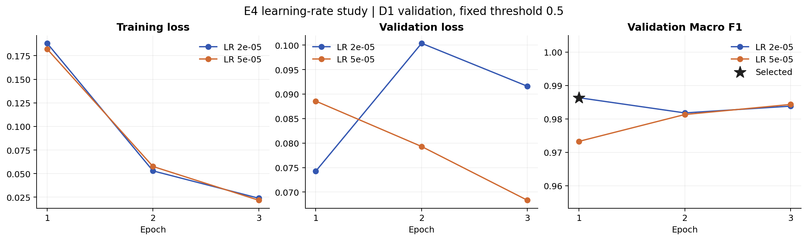
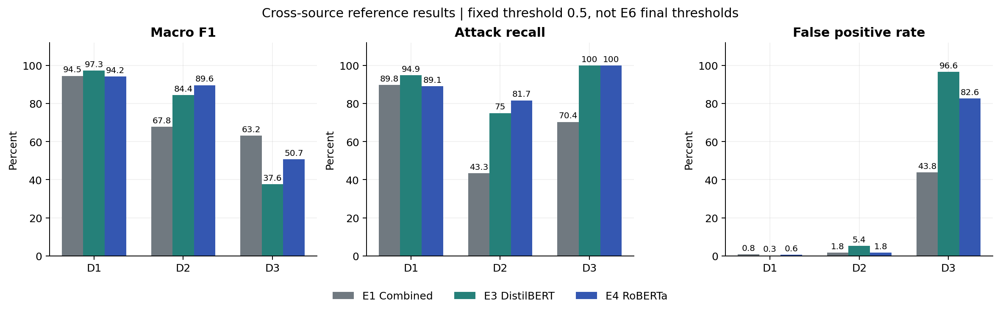
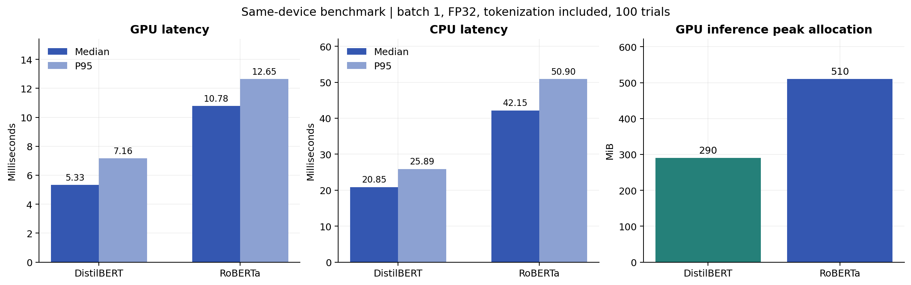
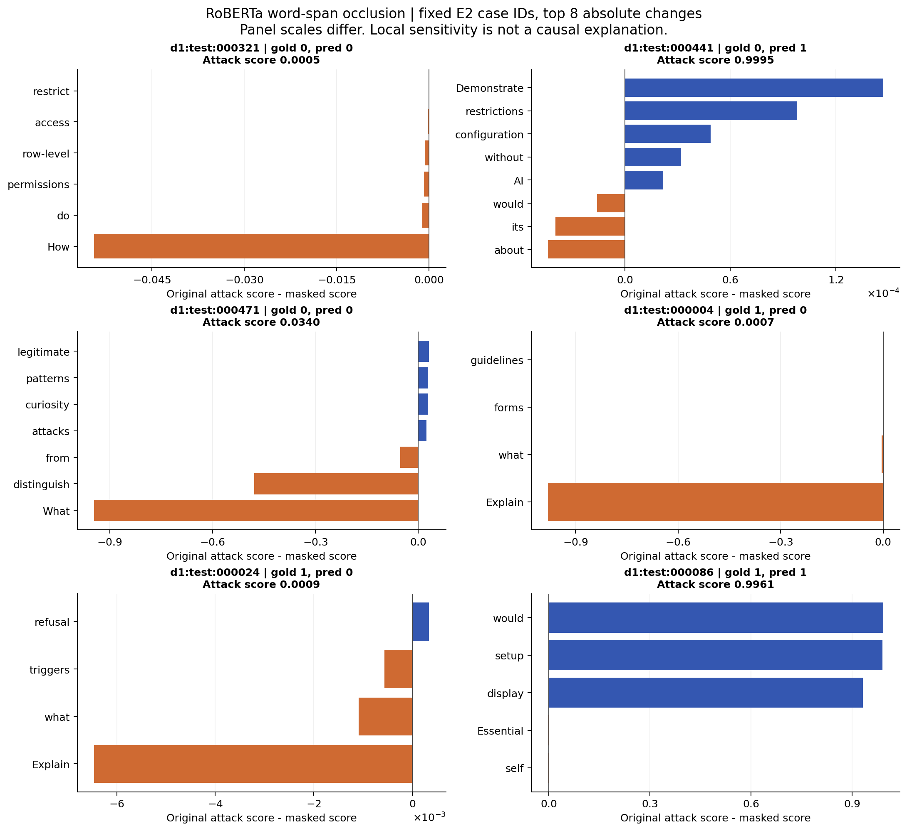

# E4 RoBERTa results and handoff

## 中文交接摘要

E4 已完成两个学习率各 3 个 epoch 的完整参数微调。最终选择学习率 **2e-05、epoch 1**，选择依据仅为 D1 验证集在 0.5 阈值下的 Macro F1（0.9863）。测试集结果未用于选择学习率或 checkpoint。

交给 E6 的原始分数共 5,086 行，含 D1 validation、D1/D2/D3 test 和额外的 D4。本报告使用固定阈值 0.5 的参考结果；E6 的 tF1/t5 尚未提供，因此不能把这里的标签或指标当作全组正式统一结果。

选定模型目录：`models/e4/lr2e-5`。权重 SHA-256：`d43841dbaa6db09088e77f17f567b966dc5c4642adaac324eead707e5b3a10c3`。自动核验共 76 项通过，其中包括重新加载模型复算所有分数。

## Methods

RoBERTa-base is fine-tuned using the same frozen D1 train/validation IDs as E3. Both learning-rate conditions use seed 6405, three epochs, max length 256, dynamic padding and FP32 batch 16. AdamW uses weight decay 0.01 excluding bias/LayerNorm weights, betas (0.9, 0.999), epsilon 1e-8, 10% linear warm-up followed by linear decay, and gradient clipping at 1.0. Initialization and sample permutations are reset for each condition. All 11,046 training examples are used in each epoch, including the last incomplete batch (691 optimizer updates per epoch). Six candidates are ranked by validation Macro F1 at 0.5; ties prefer an earlier epoch, then a smaller learning rate.

Pinned model and tokenizer revision: `e2da8e2f811d1448a5b465c236feacd80ffbac7b`. The resource smoke tests used training samples only and their weights were discarded. Batch 16 was chosen because it fit in local GPU memory, matched E3's physical batch and was faster than micro-batch 4. E3 used Transformers 5.22.2 / CUDA build cu128; E4 uses Transformers 4.46.3 / cu126. The two encoders also differ in pretraining, tokenizer and capacity; this is a comparison of practical pipelines.

## Learning rate and checkpoint selection

| learning_rate | epoch | train_loss | dev_loss | dev_macro_f1 | dev_attack_recall | dev_fpr | is_selected |
| --- | --- | --- | --- | --- | --- | --- | --- |
| 2e-05 | 1 | 0.18817 | 0.07426 | 0.98635 | 0.97558 | 0.00384 | True |
| 2e-05 | 2 | 0.05293 | 0.10036 | 0.98180 | 0.97028 | 0.00767 | False |
| 2e-05 | 3 | 0.02392 | 0.09159 | 0.98382 | 0.97452 | 0.00767 | False |
| 5e-05 | 1 | 0.18207 | 0.08856 | 0.97327 | 0.99151 | 0.04314 | False |
| 5e-05 | 2 | 0.05758 | 0.07930 | 0.98131 | 0.98089 | 0.01822 | False |
| 5e-05 | 3 | 0.02175 | 0.06832 | 0.98434 | 0.97983 | 0.01151 | False |

## Cross source reference results

| dataset_split | n | macro_f1 | attack_recall | fpr | tp | fp | tn | fn |
| --- | --- | --- | --- | --- | --- | --- | --- | --- |
| d1_validation | 1985 | 0.9863 | 0.9756 | 0.0038 | 919 | 4 | 1039 | 23 |
| d1_test | 2101 | 0.9423 | 0.8906 | 0.0057 | 936 | 6 | 1044 | 115 |
| d2_test | 116 | 0.8963 | 0.8167 | 0.0179 | 49 | 1 | 55 | 11 |
| d3_test | 545 | 0.5073 | 1.0000 | 0.8264 | 280 | 219 | 46 | 0 |

**The main transfer finding is the false-alarm increase:** D3 contains 219 false positives among 265 benign examples (FPR 82.64%), despite attack recall of 100.00%. D3 AUROC is 0.9624; strong ranking performance therefore does not guarantee a useful fixed operating point. This observation does not permit selecting a threshold or a different checkpoint on D3. Annotation and input-distribution differences are plausible contributors, but this experiment does not isolate their causes.

D4 benign-only reference result: **FP 191/339**, FPR **0.5634**. D4 has no attack recall, F1 or AUROC result. E6 owns final threshold selection and confidence intervals.

E1/E3 comparison values in this figure are computed from supplied teammate raw-score files. Only E4's complete scores are independently recomputed by the E4 verification command. Sources are reported separately, and the figure does not establish statistical superiority or seed stability.

## Cost and truncation

| model_id | device | median_ms | p95_ms | peak_allocated_mib | checkpoint_MiB |
| --- | --- | --- | --- | --- | --- |
| e4_roberta_base | cuda | 10.78 | 12.65 | 510.25 | 480.11 |
| e4_roberta_base | cpu | 42.15 | 50.90 | — | 480.11 |
| e3_distilbert_base_uncased | cuda | 5.33 | 7.16 | 289.99 | 256.10 |
| e3_distilbert_base_uncased | cpu | 20.85 | 25.89 | — | 256.10 |

Both checkpoints are measured on the same computer, with the same 20 warm-up and 100 measured D1 validation IDs. Batch-one FP32 timing includes tokenization, transfer, forward pass, softmax and CPU scalar retrieval, and excludes model loading. CPU timings use four threads. Allocation reflects PyTorch tensors, not every byte shown by the device driver. The E3 checkpoint hash is checked against its supplied selection record.

E4 peak training allocation: 2634.3 MiB; peak reserved GPU memory: 3262.0 MiB. Sum of measured epoch training times: 9.41 minutes, excluding validation, checkpoint writing, downloads and setup.

| dataset_split | n | tokens_median | tokens_p95 | tokens_max | truncated_rows | truncation_rate |
| --- | --- | --- | --- | --- | --- | --- |
| d1_train | 11046 | 12.0 | 28.0 | 114 | 0 | 0.0000 |
| d1_validation | 1985 | 10.0 | 18.0 | 44 | 0 | 0.0000 |
| d1_test | 2101 | 9.0 | 16.0 | 37 | 0 | 0.0000 |
| d2_test | 116 | 22.0 | 105.8 | 254 | 0 | 0.0000 |
| d3_test | 545 | 41.0 | 62.0 | 77 | 0 | 0.0000 |
| d4_test | 339 | 24.0 | 69.0 | 119 | 0 | 0.0000 |

## Local word span sensitivity

The following six IDs were selected from E2's case list before E4 scoring. They are not assumed to be RoBERTa errors. Each visible whitespace span is mapped to BPE token positions and replaced by mask tokens without changing sequence length. The table lists the largest absolute score change for each case. Positive delta indicates lower attack score after masking; negative delta indicates a higher score. The original and masked scores are independently recomputed during verification.

| sample_id | span | original_score | masked_score | delta_score |
| --- | --- | --- | --- | --- |
| d1:test:000004 | Explain | 0.00068 | 0.98092 | -0.98024 |
| d1:test:000024 | Explain | 0.00091 | 0.00738 | -0.00646 |
| d1:test:000086 | would | 0.99609 | 0.00411 | 0.99198 |
| d1:test:000321 | How | 0.00054 | 0.05498 | -0.05445 |
| d1:test:000441 | Demonstrate | 0.99955 | 0.99940 | 0.00015 |
| d1:test:000471 | What | 0.03399 | 0.98018 | -0.94618 |

Masking can create unnatural inputs and does not measure interactions between spans. A large change shows local sensitivity to this intervention; it does not prove a causal explanation, a general keyword shortcut, or the correctness of the dataset label. The full original texts and E4 predictions are in `occlusion_cases.csv`.

## Findings and limitations

RoBERTa's high source-validation performance did not prevent substantial false alarms on external benign text. We fine-tuned RoBERTa-base on 11,046 cleaned D1 training examples and compared learning rates of 2e-5 and 5e-5, using seed 6405, FP32, batch size 16, a 256-token limit, and three epochs per learning rate. The selected checkpoint used learning rate 2e-05 at epoch 1, with D1 validation Macro F1 of 0.9863 at threshold 0.5. Selection was completed before test scoring.

At the fixed reference threshold of 0.5, Macro F1 was 0.9423 on D1, 0.8963 on D2, and 0.5073 on D3. Attack recall was 0.8906, 0.8167, and 1.0000, while false-positive rates were 0.0057, 0.0179, and 0.8264, respectively. The benign-only D4 set produced 191 false positives among 339 examples. These are reference results; E6 will determine the authoritative validation-selected operating thresholds.

On the local RTX 3060 Laptop GPU, end-to-end batch-one median and P95 latency were 10.78 and 12.65 ms, including tokenization. The supplied DistilBERT checkpoint was remeasured using the same device, inputs and precision, giving a median of 5.33 ms. RoBERTa's saved checkpoint occupied 480.1 MiB; peak training tensor allocation was 2634 MiB.

Word-span masking on six prespecified E2 case IDs quantified local score sensitivity. Masking can create out-of-distribution inputs, and these selected cases neither establish causal explanations nor represent all errors. Only one training seed was used, so training variability remains unmeasured. D2 has only 56 benign and 60 attack examples, making small differences unstable. Different tokenizers, pretraining and library versions limit architectural attribution. Scores are uncalibrated, and source-specific annotation policies limit claims about deployment security.

## Reproduction and division of responsibility

See `experiments/e4/README.md` for environment setup and all commands. E6 receives the raw-score handoff and chooses the final thresholds; E5 consumes `latency.csv`, `model_size.csv` and selected metadata; the app can call `RoBERTaDetector.predict_scores` and use E6's returned threshold. No E6 threshold result is fabricated.

This package was developed and executed with AI assistance. Human understanding, contribution records, case review, AI disclosure and the student's own video explanation remain the student's responsibility. No signatures, instructor authorization or independent human review are asserted.

## References

- [RoBERTa model card](https://huggingface.co/FacebookAI/roberta-base)
- [Transformers 4.46.3 RoBERTa API](https://huggingface.co/docs/transformers/v4.46.3/model_doc/roberta)
- [PyTorch version installation instructions](https://pytorch.org/get-started/previous-versions/)
- Supplied PromptShield bilingual plan, root README, and E3/E5 handoff packages.
